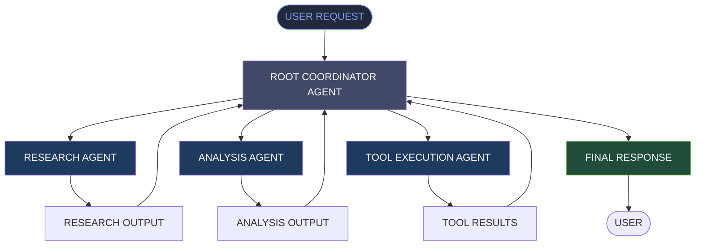

# ⚡ AHRAR AHMAD | AI ENGINEER

<p align="center">
  
</p>

<p align="center">
  
</p>

<p align="center">
  <a href="https://github.com/Ahrar-1898">
    
  </a>
  <a href="https://github.com/Ahrar-1898?tab=followers">
    
  </a>
  
</p>

---

## ◈ 01 / PROFESSIONAL PROFILE

I am **Ahrar Ahmad**, an AI Engineer and Computer Science Engineering student passionate about building intelligent applications, LLM-powered systems, and autonomous AI agents.

My technical interests span **Machine Learning, Natural Language Processing, Generative AI, Retrieval-Augmented Generation (RAG), and Agentic AI**.

I enjoy transforming AI concepts into practical software solutions by combining Python, modern AI frameworks, backend technologies, databases, and cloud services.

Currently, I am exploring **Google Agent Development Kit (ADK)** and developing my understanding of **multi-agent systems, agent orchestration, and collaborative AI workflows**.

```python
class AhrarAhmad:
    role = "AI Engineer"
    education = "B.Tech Computer Science Engineering"
    college = "IEC College of Engineering & Technology"

    interests = [
        "Machine Learning",
        "Generative AI",
        "Agentic AI",
        "LLM Applications",
        "Multi-Agent Systems",
        "Model Context Protocol"
    ]

    currently_learning = [
        "Google ADK",
        "Multi-Agent Orchestration",
        "Advanced RAG"
    ]

    currently_building = [
        "MCP-Based Expense Tracker",
        "Multi-Agent AI Systems"
    ]

    def mission(self):
        return "Build intelligent systems that solve real-world problems."
```

### ◈ Quick Overview

| Category | Details |
|---|---|
| Name | Ahrar Ahmad |
| Primary Role | AI Engineer |
| Education | B.Tech CSE (2023–2027) |
| Institution | IEC College of Engineering & Technology |
| Current Internship | AI Intern – Zee Media Corporation Limited |
| Previous Internship | AI/ML & Web Development – Minds Task Technologies |
| Primary Language | Python |
| Current Focus | Google ADK & Multi-Agent AI |
| Development Focus | Generative AI, RAG, MCP & Backend Engineering |

---

## ◈ 02 / TECH STACK ARSENAL

### `01` Programming Languages

<p>
  
</p>

### `02` Artificial Intelligence & Machine Learning

<p>
  
  
  
  
  
</p>

### `03` Generative AI & Agentic AI

<p>
  
  
  
  
  
  
  
  
  
  
</p>

### `04` Backend & Full-Stack Development

<p>
  
  
  
</p>

### `05` DevOps & Developer Tools

<p>
  
  
  
</p>

---

## ◈ 03 / FEATURED PROJECTS

Building practical applications that combine machine learning, LLMs, backend systems, and intelligent automation.

| Project | Technologies | Overview |
|:---|:---|:---|
| **Expense Tracker MCP Server** | Python, FastMCP, MCP, PostgreSQL, Neon | Custom MCP server with expense management, credits, database integration and tool execution. |
| **YouTube AI Chatbot** | Python, LangChain, RAG, FAISS, Hugging Face, Ollama, FastAPI | Context-aware video question-answering using transcript retrieval and LLMs. |
| **3D Interactive Developer Portfolio** | Next.js, React, Three.js | Interactive 3D portfolio experience with modern frontend technologies. |
| **AI Desktop Assistant / JARVIS** | Python, Node.js, Voice Processing | Voice-interactive desktop automation and information retrieval. |
| **Insurance Premium Prediction API** | Python, Scikit-learn, FastAPI, Docker | Machine learning regression application with API-based deployment. |
| **Email & SMS Spam Classifier** | Python, NLTK, TF-IDF, Streamlit | Text classification application for spam detection. |
| **Task Master Web Application** | Python, Flask | Task management application with backend logic and web interface. |

> Explore my repositories for source code, implementation details, and project documentation.

---

## ◈ 04 / AGENTIC AI LAB

Currently expanding my knowledge of **Google Agent Development Kit (ADK)** and multi-agent system design.

My learning direction includes:

- Building LLM-powered agents with Google ADK.
- Designing root agents and specialized sub-agents.
- Agent delegation and orchestration.
- Sequential, parallel and loop-based workflows.
- Integrating external tools into agents.
- Managing agent sessions and state.
- Developing collaborative AI workflows.

### Multi-Agent System – Conceptual Architecture



*Illustrative architecture representing my current learning direction, not a claim of a fully deployed multi-agent production system.*

---

## ◈ 05 / PROFESSIONAL EXPERIENCE

### AI Intern | Zee Media Corporation Limited

**November 2026 – Present**

- Exploring practical AI workflows and development processes.
- Working with audio-processing workflows.
- Learning audio extraction, cleaning, segmentation and speaker diarization.
- Exploring FFmpeg and Google Cloud Storage.

### AI/ML & Web Development Intern | Minds Task Technologies Pvt. Ltd.

**Completed**

- Gained professional exposure to AI/ML and web development.
- Participated in technical learning and development activities.
- Successfully completed the internship and received a completion certificate.

---

## ◈ 06 / CURRENT LEARNING & DEVELOPMENT

| Focus Area | Current Direction |
|---|---|
| Google ADK | Agent creation and tool integration |
| Multi-Agent AI | Agent delegation and orchestration |
| LangGraph | Stateful agent workflows |
| Advanced RAG | Retrieval optimization and evaluation |
| MCP | Advanced tool integration and server development |
| Backend Engineering | APIs and production application development |
| Audio AI | Processing and speaker diarization |

---

## ◈ 07 / GITHUB PERFORMANCE METRICS

### GitHub Statistics

<p align="center">
  

  
</p>

### Contribution Activity

<p align="center">
  
</p>

### Contribution Snake

<p align="center">
  
</p>

---

## ◈ 08 / CONNECT WITH ME

<p align="center">
  <a href="https://linkedin.com/in/ahrar-cto">
    
  </a>
  <a href="mailto:ahrarsiddiqui74@gmail.com">
    
  </a>
  <a href="https://github.com/Ahrar-1898">
    
  </a>
  <a href="https://hub.docker.com/u/ahrar123">
    
  </a>
</p>

<p align="center">
  
</p>

<p align="center">
  <b>⚡ Building intelligent systems. Learning continuously. Engineering the future.</b>
</p>

<p align="center">
  <i>Thanks for visiting my GitHub profile!</i>
</p>
